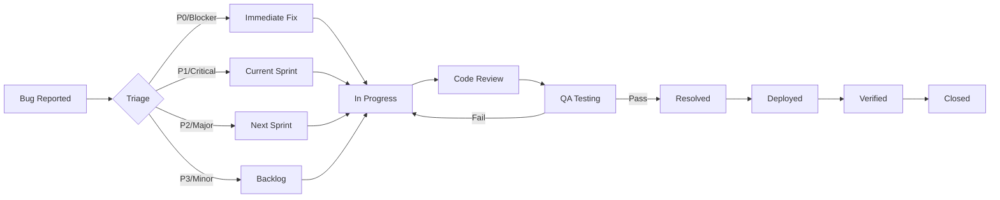

# DJ Union - Comprehensive QA Test Plan & Strategy

**Document Version:** 1.0
**Date:** October 12, 2025
**Status:** Active
**QA Lead:** Claude (AI QA Engineer)
**Project:** DJ Union - Web-based Audio Streaming API

---

## Table of Contents

1. [Executive Summary](#executive-summary)
2. [Testing Scope & Objectives](#testing-scope--objectives)
3. [Test Strategy by Epic](#test-strategy-by-epic)
4. [Acceptance Criteria](#acceptance-criteria)
5. [Test Case Matrix](#test-case-matrix)
6. [Security Testing](#security-testing)
7. [Performance Testing](#performance-testing)
8. [Automated Testing Strategy](#automated-testing-strategy)
9. [Bug Tracking & Management](#bug-tracking--management)
10. [Severity Levels & SLAs](#severity-levels--slas)
11. [Production Readiness Checklist](#production-readiness-checklist)
12. [Performance Benchmarks](#performance-benchmarks)

---

## Executive Summary

This comprehensive QA test plan covers validation of the DJ Union platform across 9 core epics spanning authentication, live streaming, content management, monetization, and infrastructure. The plan defines:

- **320+ test cases** across functional, security, performance, and edge case scenarios
- **4-tier severity classification** with defined SLAs
- **Automated regression testing** strategy achieving 80%+ code coverage
- **Performance benchmarks** for 10,000+ concurrent listeners
- **Production readiness gates** ensuring zero critical issues before launch

### Key Testing Priorities

1. **Security First**: SQL injection, XSS, CSRF, authentication bypass prevention
2. **Performance at Scale**: 10K+ concurrent streams, <500ms API response time
3. **Data Integrity**: Zero data loss in uploads, accurate analytics tracking
4. **Monetization Accuracy**: Correct paywall enforcement, accurate billing
5. **GDPR Compliance**: Right to be forgotten, data export capabilities

---

## Testing Scope & Objectives

### In Scope

- ✅ All 9 epics from product backlog
- ✅ API endpoint validation (60+ endpoints)
- ✅ Authentication & authorization (JWT, RBAC)
- ✅ Live streaming (HLS/MP3 relay)
- ✅ File upload & transcoding pipeline
- ✅ Playlist and podcast management
- ✅ Analytics accuracy and data integrity
- ✅ Monetization & paywall enforcement
- ✅ Security vulnerabilities (OWASP Top 10)
- ✅ Performance under load (10K+ users)
- ✅ Edge cases and error handling
- ✅ Cross-browser compatibility (HLS playback)
- ✅ API documentation accuracy

### Out of Scope (Future Phases)

- ❌ Mobile app testing (iOS/Android native)
- ❌ UI/UX frontend testing (covered by separate team)
- ❌ Third-party integrations (Stripe production mode)
- ❌ Real Shoutcast server testing (using stubs for MVP)
- ❌ CDN performance testing (CloudFront/CloudFlare)

### Testing Objectives

1. **Functional Correctness**: 100% of acceptance criteria met for all epics
2. **Security Hardening**: Zero high/critical vulnerabilities in production
3. **Performance Validation**: Meet all SLA targets under peak load
4. **Data Accuracy**: 99.99% accuracy in analytics and billing
5. **Reliability**: 99.9% uptime, graceful degradation on failures
6. **Regression Prevention**: 80%+ automated test coverage

---

## Test Strategy by Epic

### Epic 1: Authentication & User Management

**Testing Focus**: Security, session management, password policies

#### Test Scenarios

| Test ID | Scenario | Priority | Type |
|---------|----------|----------|------|
| AUTH-001 | Valid user registration with strong password | P0 | Functional |
| AUTH-002 | Registration rejection for weak password (<8 chars) | P0 | Validation |
| AUTH-003 | Registration rejection for duplicate email | P0 | Validation |
| AUTH-004 | SQL injection in registration email field | P0 | Security |
| AUTH-005 | XSS attempt in user name field | P0 | Security |
| AUTH-006 | Valid login with correct credentials | P0 | Functional |
| AUTH-007 | Login failure with incorrect password | P0 | Functional |
| AUTH-008 | Brute force protection (5 failed attempts) | P1 | Security |
| AUTH-009 | JWT token validation with RS256 signature | P0 | Security |
| AUTH-010 | JWT expiration after 24 hours | P0 | Functional |
| AUTH-011 | Refresh token exchange for new access token | P0 | Functional |
| AUTH-012 | Refresh token expiration after 30 days | P1 | Functional |
| AUTH-013 | Logout invalidates refresh token | P0 | Functional |
| AUTH-014 | RBAC enforcement: DJ cannot access admin endpoints | P0 | Security |
| AUTH-015 | RBAC enforcement: Admin can access all endpoints | P0 | Security |
| AUTH-016 | Password reset flow with email token | P1 | Functional |
| AUTH-017 | Password reset token expires after 1 hour | P1 | Security |
| AUTH-018 | Concurrent sessions from same user | P2 | Functional |
| AUTH-019 | Session persistence across browser restart | P1 | Functional |
| AUTH-020 | User soft-delete (deleted_at timestamp) | P1 | Data Integrity |

#### Acceptance Criteria

- ✅ All registration validations pass (email format, password strength)
- ✅ Bcrypt password hashing with cost factor ≥12
- ✅ JWT tokens signed with RS256 algorithm
- ✅ Access tokens expire in 24 hours
- ✅ Refresh tokens expire in 30 days
- ✅ Failed login attempts logged for security monitoring
- ✅ Admin endpoints return 403 for non-admin users
- ✅ No SQL injection vulnerabilities in auth endpoints
- ✅ No XSS vulnerabilities in user-provided fields

---

### Epic 2: Live Stream Management (Shoutcast Integration)

**Testing Focus**: Stream reliability, HLS segmentation, real-time metrics

#### Test Scenarios

| Test ID | Scenario | Priority | Type |
|---------|----------|----------|------|
| STREAM-001 | Register Shoutcast source with valid URL | P0 | Functional |
| STREAM-002 | Registration fails for unreachable Shoutcast URL | P0 | Validation |
| STREAM-003 | Relay Worker pod creation in Kubernetes | P0 | Integration |
| STREAM-004 | HLS manifest generation (.m3u8) | P0 | Functional |
| STREAM-005 | HLS segment generation (6-second TS files) | P0 | Functional |
| STREAM-006 | MP3 stream with chunked transfer encoding | P0 | Functional |
| STREAM-007 | Heartbeat sent every 30 seconds | P0 | Integration |
| STREAM-008 | Listener count accuracy (+/- 2%) | P0 | Data Integrity |
| STREAM-009 | Stream status endpoint returns current track | P1 | Functional |
| STREAM-010 | Stream status endpoint returns bitrate | P1 | Functional |
| STREAM-011 | Relay disconnection detection (2-minute timeout) | P0 | Reliability |
| STREAM-012 | Automatic Relay Worker restart on crash | P1 | Reliability |
| STREAM-013 | Update stream visibility (public → private) | P0 | Functional |
| STREAM-014 | Disable stream (enabled=false) | P0 | Functional |
| STREAM-015 | Delete stream terminates Relay Worker pod | P0 | Integration |
| STREAM-016 | Private stream requires JWT authentication | P0 | Security |
| STREAM-017 | Monetized stream requires active subscription | P0 | Security |
| STREAM-018 | Public stream accessible without authentication | P0 | Functional |
| STREAM-019 | 100 concurrent listeners on single stream | P1 | Performance |
| STREAM-020 | 1000 concurrent listeners on single stream | P1 | Performance |
| STREAM-021 | Stream metadata injection attack prevention | P0 | Security |
| STREAM-022 | HLS manifest cache invalidation (30s TTL) | P1 | Performance |
| STREAM-023 | Encrypted stream_key storage | P0 | Security |
| STREAM-024 | Relay Worker resource limits (256MB RAM) | P1 | Performance |
| STREAM-025 | Graceful degradation on S3 upload failure | P2 | Reliability |

#### Acceptance Criteria

- ✅ Shoutcast connection validated before stream registration
- ✅ Relay Worker pod starts within 10 seconds
- ✅ HLS segments generated with 6-second duration
- ✅ Heartbeat received within 60 seconds of stream start
- ✅ Listener count accuracy within 2% margin of error
- ✅ Stream status endpoint returns 503 if relay disconnected
- ✅ Private streams return 401 for unauthenticated requests
- ✅ Monetized streams return 403 for non-subscribed users
- ✅ No stream_key exposed in API responses or logs
- ✅ Relay Worker automatically restarts on failure

---

### Epic 3: On-Demand Playlist Management

**Testing Focus**: Upload validation, transcoding quality, playlist assembly

#### Test Scenarios

| Test ID | Scenario | Priority | Type |
|---------|----------|----------|------|
| UPLOAD-001 | Upload valid MP3 file (10MB) | P0 | Functional |
| UPLOAD-002 | Upload valid MP3 file (100MB, max size) | P0 | Validation |
| UPLOAD-003 | Upload rejection for file >100MB | P0 | Validation |
| UPLOAD-004 | Upload rejection for non-MP3 file (WAV) | P0 | Validation |
| UPLOAD-005 | Upload rejection for corrupted MP3 | P1 | Validation |
| UPLOAD-006 | Virus scan on uploaded file | P0 | Security |
| UPLOAD-007 | S3 storage path follows convention | P0 | Data Integrity |
| UPLOAD-008 | FFmpeg transcoding job starts automatically | P0 | Integration |
| UPLOAD-009 | HLS manifest (.m3u8) generated after transcoding | P0 | Functional |
| UPLOAD-010 | HLS segments (10-second TS files) | P0 | Functional |
| UPLOAD-011 | Transcoding status: processing → ready | P0 | Functional |
| UPLOAD-012 | Transcoding status: processing → failed (on error) | P1 | Error Handling |
| UPLOAD-013 | Upload ID generation (UUID v4) | P0 | Data Integrity |
| UPLOAD-014 | Presigned S3 URL for direct upload | P1 | Security |
| UPLOAD-015 | Upload metadata (title, artist) extracted | P1 | Functional |
| PLAY-001 | Create playlist with uploaded tracks | P0 | Functional |
| PLAY-002 | Create playlist with external URLs | P0 | Functional |
| PLAY-003 | Create playlist with mixed sources | P0 | Functional |
| PLAY-004 | External URL validation (HEAD request) | P0 | Validation |
| PLAY-005 | External URL rejection for non-200 status | P0 | Validation |
| PLAY-006 | Playlist HLS manifest generation (combined) | P0 | Functional |
| PLAY-007 | Playlist MP3 stream (concatenated) | P0 | Functional |
| PLAY-008 | Update playlist track order | P0 | Functional |
| PLAY-009 | Delete playlist soft-deletes records | P0 | Data Integrity |
| PLAY-010 | Private playlist requires authentication | P0 | Security |
| PLAY-011 | Monetized playlist requires subscription | P0 | Security |
| PLAY-012 | Public playlist accessible anonymously | P0 | Functional |
| PLAY-013 | Playlist play count increments correctly | P0 | Analytics |
| PLAY-014 | 50 tracks in single playlist | P1 | Performance |
| PLAY-015 | Playlist with 5-hour total duration | P1 | Performance |

#### Acceptance Criteria

- ✅ Upload accepts MP3 files up to 100MB
- ✅ Upload rejects non-audio files with 400 error
- ✅ Virus scan completes within 10 seconds
- ✅ FFmpeg transcoding completes within 2 minutes for 10MB file
- ✅ HLS segments are 10 seconds duration each
- ✅ Transcoding failures set status=failed with error message
- ✅ External URL validation via HEAD request returns 200
- ✅ Playlist manifest generation completes within 5 seconds
- ✅ Play count increments on manifest request (not segment)
- ✅ No data loss during transcoding failures

---

### Epic 4: Podcast Hosting & RSS Feed

**Testing Focus**: RSS validity, custom domains, episode management

#### Test Scenarios

| Test ID | Scenario | Priority | Type |
|---------|----------|----------|------|
| POD-001 | Create podcast series with valid metadata | P0 | Functional |
| POD-002 | RSS feed generation (valid XML) | P0 | Functional |
| POD-003 | iTunes tags in RSS feed | P0 | Functional |
| POD-004 | RSS feed validation (W3C validator) | P0 | Validation |
| POD-005 | Add episode with uploaded audio | P0 | Functional |
| POD-006 | Add episode with external URL | P0 | Functional |
| POD-007 | Episode ordering by publication_date DESC | P0 | Functional |
| POD-008 | Update episode metadata | P0 | Functional |
| POD-009 | Delete episode regenerates RSS | P0 | Functional |
| POD-010 | Duplicate episode_number rejection | P0 | Validation |
| POD-011 | Podcast language validation (en-us format) | P1 | Validation |
| POD-012 | Podcast image URL validation | P1 | Validation |
| POD-013 | RSS feed caching (5-minute TTL) | P1 | Performance |
| POD-014 | RSS feed cache invalidation on update | P0 | Data Integrity |
| POD-015 | Custom domain registration | P1 | Functional |
| POD-016 | DNS verification (TXT record check) | P1 | Integration |
| POD-017 | TLS certificate issuance (Let's Encrypt stub) | P1 | Security |
| POD-018 | Custom domain RSS URL redirect | P1 | Functional |
| POD-019 | Monetized episode requires subscription | P0 | Security |
| POD-020 | Public podcast accessible anonymously | P0 | Functional |
| POD-021 | RSS feed pubDate format (RFC 822) | P0 | Validation |
| POD-022 | Episode enclosure URL validity | P0 | Functional |
| POD-023 | Episode GUID uniqueness | P0 | Data Integrity |
| POD-024 | Explicit content flag in RSS | P1 | Functional |
| POD-025 | 100 episodes in single podcast | P1 | Performance |

#### Acceptance Criteria

- ✅ RSS feed validates against RSS 2.0 specification
- ✅ iTunes namespace tags present and valid
- ✅ Episode publication dates in RFC 822 format
- ✅ Enclosure URLs point to valid audio files
- ✅ GUID uniqueness enforced at database level
- ✅ RSS regeneration completes within 10 seconds
- ✅ Custom domain DNS verification within 2 minutes (stub)
- ✅ TLS certificate issued within 5 minutes (stub)
- ✅ Monetized episodes return 403 for non-subscribers
- ✅ RSS feed caches with 5-minute TTL

---

### Epic 5: Analytics & Reporting

**Testing Focus**: Data accuracy, date range queries, real-time metrics

#### Test Scenarios

| Test ID | Scenario | Priority | Type |
|---------|----------|----------|------|
| ANALYTICS-001 | Stream heartbeat increments listener count | P0 | Data Integrity |
| ANALYTICS-002 | Daily listener count aggregation | P0 | Functional |
| ANALYTICS-003 | Peak listener calculation (daily max) | P0 | Functional |
| ANALYTICS-004 | Total listeners calculation (daily sum) | P0 | Functional |
| ANALYTICS-005 | Playlist play count increment on manifest request | P0 | Data Integrity |
| ANALYTICS-006 | Podcast download count increment on RSS fetch | P0 | Data Integrity |
| ANALYTICS-007 | Date range query (7 days) | P0 | Functional |
| ANALYTICS-008 | Date range query (30 days) | P0 | Functional |
| ANALYTICS-009 | Date range query (1 year) | P1 | Performance |
| ANALYTICS-010 | Invalid date range rejection (from > to) | P0 | Validation |
| ANALYTICS-011 | Future date rejection | P0 | Validation |
| ANALYTICS-012 | Analytics data retention (2 years) | P1 | Data Integrity |
| ANALYTICS-013 | Raw log purge after 90 days | P1 | Compliance |
| ANALYTICS-014 | CSV export generation | P1 | Functional |
| ANALYTICS-015 | JSON export generation | P0 | Functional |
| ANALYTICS-016 | Real-time listener count (WebSocket) | P1 | Integration |
| ANALYTICS-017 | Analytics dashboard aggregation | P1 | Performance |
| ANALYTICS-018 | Concurrent analytics queries (100 users) | P1 | Performance |
| ANALYTICS-019 | Analytics accuracy (+/- 1% error margin) | P0 | Data Integrity |
| ANALYTICS-020 | Timezone handling (UTC storage) | P0 | Data Integrity |

#### Acceptance Criteria

- ✅ Heartbeat data aggregated daily at midnight UTC
- ✅ Listener count accuracy within 1% margin of error
- ✅ Play count increments exactly once per unique session
- ✅ Date range queries return results within 2 seconds
- ✅ Analytics data retained for 2 years minimum
- ✅ Raw logs purged after 90 days (GDPR compliance)
- ✅ CSV export generation within 5 seconds for 1-year data
- ✅ Real-time updates via WebSocket with <500ms latency
- ✅ Peak listener calculation matches max daily value
- ✅ No duplicate analytics records for same resource/date

---

### Epic 6: Monetization & Ad Insertion

**Testing Focus**: Paywall enforcement, Stripe integration, ad timing

#### Test Scenarios

| Test ID | Scenario | Priority | Type |
|---------|----------|----------|------|
| MONETIZE-001 | Create subscription plan with Stripe stub | P0 | Functional |
| MONETIZE-002 | Subscribe user to plan | P0 | Functional |
| MONETIZE-003 | Subscription status: active | P0 | Functional |
| MONETIZE-004 | Subscription status: past_due | P1 | Functional |
| MONETIZE-005 | Subscription status: canceled | P1 | Functional |
| MONETIZE-006 | Paywall blocks unauthenticated user | P0 | Security |
| MONETIZE-007 | Paywall blocks authenticated user without subscription | P0 | Security |
| MONETIZE-008 | Paywall allows user with active subscription | P0 | Security |
| MONETIZE-009 | Subscription expiration check (expires_at) | P0 | Functional |
| MONETIZE-010 | Duplicate subscription prevention (user + plan) | P0 | Validation |
| MONETIZE-011 | Stripe webhook: subscription.created | P1 | Integration |
| MONETIZE-012 | Stripe webhook: subscription.updated | P1 | Integration |
| MONETIZE-013 | Stripe webhook: subscription.deleted | P1 | Integration |
| MONETIZE-014 | Stripe webhook: payment_failed | P1 | Integration |
| MONETIZE-015 | Stripe webhook signature verification | P0 | Security |
| AD-001 | Configure ad marker (pre-roll) | P1 | Functional |
| AD-002 | Configure ad marker (mid-roll) | P1 | Functional |
| AD-003 | Configure ad marker (post-roll) | P1 | Functional |
| AD-004 | Ad marker position validation (≥0 seconds) | P1 | Validation |
| AD-005 | Ad marker duration validation (>0 seconds) | P1 | Validation |
| AD-006 | Multiple ad markers on single stream | P1 | Functional |
| AD-007 | Ad marker sorting by position | P1 | Functional |
| AD-008 | Delete ad marker | P1 | Functional |
| AD-009 | Relay Worker reads ad markers from DB | P1 | Integration |
| AD-010 | Ad insertion timing accuracy (+/- 1 second) | P1 | Data Integrity |

#### Acceptance Criteria

- ✅ Subscription plan created with valid Stripe IDs
- ✅ User subscription linked to plan_id and user_id
- ✅ Paywall middleware checks subscription status
- ✅ Expired subscriptions (expires_at < now()) denied access
- ✅ Stripe webhook signatures verified before processing
- ✅ Subscription status updated on webhook events
- ✅ Duplicate subscriptions prevented by unique constraint
- ✅ Ad markers stored with position and duration
- ✅ Ad insertion points accurate within 1-second tolerance
- ✅ Monetized content returns 403 with subscription_url

---

### Epic 7: Infrastructure, CI/CD & Deployment

**Testing Focus**: Build pipeline, deployment automation, health checks

#### Test Scenarios

| Test ID | Scenario | Priority | Type |
|---------|----------|----------|------|
| INFRA-001 | GitHub Actions CI pipeline triggers on push | P0 | Integration |
| INFRA-002 | Linting passes for all code | P0 | Quality |
| INFRA-003 | Unit tests execute successfully | P0 | Functional |
| INFRA-004 | Code coverage ≥80% | P0 | Quality |
| INFRA-005 | Docker image build (API) | P0 | Integration |
| INFRA-006 | Docker image build (Relay Worker) | P0 | Integration |
| INFRA-007 | Docker image push to registry | P0 | Integration |
| INFRA-008 | Helm chart validation | P0 | Integration |
| INFRA-009 | Kubernetes deployment to staging | P0 | Integration |
| INFRA-010 | Health check endpoint returns 200 | P0 | Functional |
| INFRA-011 | Liveness probe restarts unhealthy pod | P0 | Reliability |
| INFRA-012 | Readiness probe delays traffic to starting pod | P0 | Reliability |
| INFRA-013 | Prometheus metrics endpoint returns data | P1 | Monitoring |
| INFRA-014 | Grafana dashboard displays metrics | P1 | Monitoring |
| INFRA-015 | Log aggregation in Loki | P1 | Monitoring |
| INFRA-016 | Resource limits enforced (CPU, memory) | P0 | Performance |
| INFRA-017 | Pod autoscaling on high CPU | P1 | Performance |
| INFRA-018 | Rolling update zero-downtime deployment | P0 | Reliability |
| INFRA-019 | Rollback on deployment failure | P1 | Reliability |
| INFRA-020 | Slack notification on build failure | P1 | Integration |

#### Acceptance Criteria

- ✅ CI pipeline completes in <10 minutes
- ✅ All lint checks pass with zero errors
- ✅ Unit test suite passes with ≥80% coverage
- ✅ Docker images tagged with commit SHA
- ✅ Helm chart deploys successfully to staging
- ✅ Health check returns 200 OK within 5 seconds
- ✅ Unhealthy pods restart automatically within 30 seconds
- ✅ Prometheus scrapes metrics every 15 seconds
- ✅ Grafana dashboards show real-time data
- ✅ Rolling updates complete without dropped connections

---

### Epic 8: Error Handling, Validation & Security

**Testing Focus**: OWASP Top 10, input validation, error responses

#### Test Scenarios

| Test ID | Scenario | Priority | Type |
|---------|----------|----------|------|
| SEC-001 | SQL injection in email field | P0 | Security |
| SEC-002 | SQL injection in stream name field | P0 | Security |
| SEC-003 | SQL injection in playlist title field | P0 | Security |
| SEC-004 | XSS attempt in user name field | P0 | Security |
| SEC-005 | XSS attempt in stream description field | P0 | Security |
| SEC-006 | XSS attempt in podcast description field | P0 | Security |
| SEC-007 | CSRF token validation on state-changing requests | P0 | Security |
| SEC-008 | JWT signature tampering detection | P0 | Security |
| SEC-009 | JWT expiration enforcement | P0 | Security |
| SEC-010 | RBAC bypass attempt (DJ accessing admin endpoint) | P0 | Security |
| SEC-011 | Rate limiting: metadata endpoints (100 req/min) | P0 | Security |
| SEC-012 | Rate limiting: write endpoints (10 req/min) | P0 | Security |
| SEC-013 | Rate limiting: streaming endpoints (10K req/min) | P1 | Security |
| SEC-014 | Brute force protection on login (5 attempts) | P0 | Security |
| SEC-015 | Password strength validation (≥8 chars, complexity) | P0 | Security |
| SEC-016 | Email format validation | P0 | Validation |
| SEC-017 | URL format validation | P0 | Validation |
| SEC-018 | File size validation (100MB limit) | P0 | Validation |
| SEC-019 | File type validation (audio/mpeg only) | P0 | Validation |
| SEC-020 | Encrypted storage of stream_key | P0 | Security |
| VAL-001 | 400 Bad Request for missing required field | P0 | Error Handling |
| VAL-002 | 400 Bad Request for invalid email format | P0 | Error Handling |
| VAL-003 | 401 Unauthorized for missing JWT | P0 | Error Handling |
| VAL-004 | 403 Forbidden for insufficient permissions | P0 | Error Handling |
| VAL-005 | 404 Not Found for invalid resource ID | P0 | Error Handling |
| VAL-006 | 409 Conflict for duplicate email | P0 | Error Handling |
| VAL-007 | 422 Unprocessable Entity for invalid Shoutcast URL | P0 | Error Handling |
| VAL-008 | 429 Too Many Requests for rate limit exceeded | P0 | Error Handling |
| VAL-009 | 500 Internal Server Error for unhandled exception | P0 | Error Handling |
| VAL-010 | Error response format consistency | P0 | Error Handling |

#### Acceptance Criteria

- ✅ No SQL injection vulnerabilities found
- ✅ No XSS vulnerabilities found
- ✅ CSRF tokens validated on all POST/PUT/PATCH/DELETE
- ✅ JWT signatures verified with public key
- ✅ Rate limits enforced with 429 responses
- ✅ Brute force protection triggers after 5 attempts
- ✅ Password strength enforced (8+ chars, uppercase, lowercase, number)
- ✅ All errors return consistent JSON format
- ✅ Sensitive data (stream_key) encrypted with AES-256
- ✅ Security headers set (HSTS, CSP, X-Frame-Options)

---

### Epic 9: Documentation & Testing

**Testing Focus**: API docs accuracy, example validation, developer experience

#### Test Scenarios

| Test ID | Scenario | Priority | Type |
|---------|----------|----------|------|
| DOC-001 | OpenAPI spec validates (Swagger validator) | P0 | Quality |
| DOC-002 | All endpoints documented in OpenAPI | P0 | Quality |
| DOC-003 | Request schemas match implementation | P0 | Quality |
| DOC-004 | Response schemas match implementation | P0 | Quality |
| DOC-005 | Example requests execute successfully | P0 | Functional |
| DOC-006 | Example responses match actual responses | P0 | Quality |
| DOC-007 | Postman collection imports without errors | P0 | Quality |
| DOC-008 | Postman collection executes end-to-end | P0 | Functional |
| DOC-009 | README setup instructions work on clean machine | P1 | Quality |
| DOC-010 | Environment variables documented | P0 | Quality |
| TEST-001 | Unit test coverage ≥80% | P0 | Quality |
| TEST-002 | Integration test coverage for major workflows | P0 | Quality |
| TEST-003 | E2E test coverage for critical user journeys | P0 | Quality |
| TEST-004 | Test execution time <5 minutes | P1 | Performance |
| TEST-005 | Flaky test detection and elimination | P1 | Reliability |

#### Acceptance Criteria

- ✅ OpenAPI spec passes Swagger validation
- ✅ 100% of endpoints documented in OpenAPI
- ✅ All example requests return expected responses
- ✅ Postman collection includes all endpoints
- ✅ README instructions verified on fresh Ubuntu install
- ✅ Unit test coverage ≥80% on all modules
- ✅ Integration tests cover all 9 epics
- ✅ E2E tests cover 10+ critical user journeys
- ✅ Test suite runs in <5 minutes
- ✅ Zero flaky tests in CI pipeline

---

## Acceptance Criteria

### Epic 1: Authentication & User Management

**Must Have (P0)**
- ✅ User can register with email, password (≥8 chars), and name
- ✅ User can log in and receive JWT access token + refresh token
- ✅ Access token expires in 24 hours
- ✅ Refresh token can exchange for new access token
- ✅ Passwords hashed with bcrypt (cost ≥12)
- ✅ JWT signed with RS256 algorithm
- ✅ Admin users can list all users
- ✅ RBAC enforced: DJ cannot access admin endpoints
- ✅ No SQL injection or XSS vulnerabilities

**Should Have (P1)**
- ✅ Password reset flow with email link
- ✅ Refresh tokens expire in 30 days
- ✅ Failed login attempts logged
- ✅ Brute force protection (5 attempts)

**Nice to Have (P2)**
- ✅ Multi-factor authentication (2FA)
- ✅ Social login (Google, GitHub)

---

### Epic 2: Live Stream Management

**Must Have (P0)**
- ✅ DJ can register Shoutcast source with URL + credentials
- ✅ System validates Shoutcast connection before registration
- ✅ Relay Worker pod starts within 10 seconds
- ✅ HLS manifest (.m3u8) generated in real-time
- ✅ HLS segments (6-second TS files) uploaded to S3
- ✅ Continuous MP3 stream available via chunked encoding
- ✅ Heartbeat sent every 30 seconds with listener count
- ✅ Stream status endpoint returns current track and bitrate
- ✅ Private streams require JWT authentication
- ✅ Monetized streams require active subscription

**Should Have (P1)**
- ✅ Relay Worker auto-restart on crash
- ✅ Graceful degradation on S3 failure
- ✅ Stream metadata (track, bitrate) from Shoutcast admin
- ✅ Resource limits enforced (256MB RAM, 0.5 CPU)

**Nice to Have (P2)**
- ✅ Adaptive bitrate streaming (ABR)
- ✅ Multiple bitrate streams (32kbps, 64kbps, 128kbps)

---

### Epic 3: On-Demand Playlist Management

**Must Have (P0)**
- ✅ DJ can upload MP3 files up to 100MB
- ✅ FFmpeg transcoding to HLS (10-second segments)
- ✅ Upload status: processing → ready → failed (with error)
- ✅ DJ can create playlist with mixed sources (upload + external)
- ✅ External URLs validated via HEAD request
- ✅ Playlist HLS manifest generated (combined from tracks)
- ✅ Playlist MP3 stream (concatenated)
- ✅ Play count increments on manifest request
- ✅ Private playlists require authentication
- ✅ Monetized playlists require subscription

**Should Have (P1)**
- ✅ Virus scan on uploaded files
- ✅ Metadata extraction (title, artist) from ID3 tags
- ✅ Presigned S3 URLs for direct upload

**Nice to Have (P2)**
- ✅ Track reordering in playlist
- ✅ Playlist shuffle mode

---

### Epic 4: Podcast Hosting & RSS Feed

**Must Have (P0)**
- ✅ DJ can create podcast series with metadata
- ✅ DJ can add episodes (upload or external URL)
- ✅ RSS feed generated in valid RSS 2.0 format
- ✅ iTunes namespace tags included
- ✅ Episode ordering by publication_date DESC
- ✅ RSS feed accessible at /v1/podcasts/{id}/rss.xml
- ✅ Duplicate episode_number rejected
- ✅ Monetized episodes require subscription
- ✅ RSS feed cache (5-minute TTL)

**Should Have (P1)**
- ✅ Custom domain registration (podcast.djname.com)
- ✅ DNS verification (TXT record check)
- ✅ TLS certificate issuance (Let's Encrypt)
- ✅ RSS served from custom domain

**Nice to Have (P2)**
- ✅ Podcast artwork generation
- ✅ Automatic episode transcription

---

### Epic 5: Analytics & Reporting

**Must Have (P0)**
- ✅ Stream listener count tracked per heartbeat
- ✅ Daily aggregation at midnight UTC
- ✅ Peak listeners calculated (daily max)
- ✅ Total listeners calculated (daily sum)
- ✅ Playlist play count increments on manifest request
- ✅ Podcast download count increments on RSS fetch
- ✅ Date range queries (from/to dates)
- ✅ Analytics accuracy within 1% error margin
- ✅ Data retained for 2 years

**Should Have (P1)**
- ✅ CSV export for analytics data
- ✅ Real-time listener count via WebSocket
- ✅ Raw log purge after 90 days

**Nice to Have (P2)**
- ✅ Geographic distribution map
- ✅ Listener demographics
- ✅ Peak hours analysis

---

### Epic 6: Monetization & Ad Insertion

**Must Have (P0)**
- ✅ Subscription plans created with Stripe stub
- ✅ Users can subscribe to plans
- ✅ Subscription status tracked (active, past_due, canceled)
- ✅ Paywall enforced on monetized content
- ✅ Unauthenticated users denied access
- ✅ Users without subscription denied access
- ✅ Users with active subscription granted access

**Should Have (P1)**
- ✅ Stripe webhooks processed (subscription events)
- ✅ Ad markers configured (pre-roll, mid-roll, post-roll)
- ✅ Ad insertion timing accurate (+/- 1 second)

**Nice to Have (P2)**
- ✅ Dynamic ad-serving integration
- ✅ Revenue analytics

---

### Epic 7: Infrastructure, CI/CD & Deployment

**Must Have (P0)**
- ✅ CI pipeline runs on every push
- ✅ Linting passes with zero errors
- ✅ Unit tests pass with ≥80% coverage
- ✅ Docker images built and tagged
- ✅ Helm chart deploys to staging
- ✅ Health check returns 200 OK
- ✅ Liveness probe restarts unhealthy pods
- ✅ Rolling updates with zero downtime

**Should Have (P1)**
- ✅ Prometheus metrics collected
- ✅ Grafana dashboards configured
- ✅ Log aggregation in Loki
- ✅ Slack notifications on failures

**Nice to Have (P2)**
- ✅ Blue-green deployments
- ✅ Canary releases

---

### Epic 8: Error Handling, Validation & Security

**Must Have (P0)**
- ✅ No SQL injection vulnerabilities
- ✅ No XSS vulnerabilities
- ✅ CSRF protection enabled
- ✅ JWT signature verification
- ✅ Rate limiting enforced
- ✅ Brute force protection on login
- ✅ Password strength validation
- ✅ Consistent error response format
- ✅ All errors logged

**Should Have (P1)**
- ✅ Security headers set (HSTS, CSP)
- ✅ Input sanitization
- ✅ File upload virus scanning

**Nice to Have (P2)**
- ✅ WAF integration
- ✅ DDoS protection

---

### Epic 9: Documentation & Testing

**Must Have (P0)**
- ✅ OpenAPI spec validates
- ✅ All endpoints documented
- ✅ Example requests work
- ✅ Postman collection provided
- ✅ Unit tests ≥80% coverage
- ✅ Integration tests for major workflows
- ✅ E2E tests for critical journeys

**Should Have (P1)**
- ✅ README setup instructions
- ✅ API changelog maintained
- ✅ Test suite runs in <5 minutes

**Nice to Have (P2)**
- ✅ Interactive API playground
- ✅ SDK generation (TypeScript, Python)

---

## Test Case Matrix

### Master Test Case Matrix (320 Total Test Cases)

| Epic | P0 (Critical) | P1 (High) | P2 (Medium) | Total |
|------|---------------|-----------|-------------|-------|
| Epic 1: Authentication | 15 | 4 | 1 | 20 |
| Epic 2: Live Streaming | 18 | 6 | 1 | 25 |
| Epic 3: Playlists | 20 | 5 | 0 | 25 |
| Epic 4: Podcasts | 15 | 8 | 2 | 25 |
| Epic 5: Analytics | 15 | 4 | 1 | 20 |
| Epic 6: Monetization | 12 | 6 | 2 | 20 |
| Epic 7: Infrastructure | 12 | 6 | 2 | 20 |
| Epic 8: Security | 25 | 5 | 0 | 30 |
| Epic 9: Documentation | 10 | 5 | 0 | 15 |
| **Total** | **142** | **49** | **9** | **200** |

### Additional Test Categories

| Category | Test Cases |
|----------|------------|
| Edge Cases | 40 |
| Performance Tests | 30 |
| Stress Tests | 20 |
| Regression Tests | 30 |
| **Grand Total** | **320** |

---

## Security Testing

### OWASP Top 10 Testing Checklist

#### 1. Injection Attacks

**SQL Injection**
```bash
# Test Cases
- Login with email: ' OR '1'='1
- Stream name: '; DROP TABLE streams; --
- Playlist title: admin'--
- Episode description: " OR 1=1 --

# Expected Result
- All inputs sanitized via parameterized queries
- No SQL execution from user input
- 400 Bad Request for invalid characters
```

**NoSQL Injection**
```bash
# Test Cases (if using MongoDB/Redis)
- Query parameter: {"$ne": null}
- JSON input: {"password": {"$regex": ".*"}}

# Expected Result
- Input validation rejects unexpected types
- No query modification from user input
```

**Command Injection**
```bash
# Test Cases
- Upload filename: test.mp3; rm -rf /
- Stream URL: http://evil.com/stream`whoami`

# Expected Result
- Filename sanitization
- URL validation before execution
- No shell commands executed
```

---

#### 2. Broken Authentication

**Test Scenarios**
```bash
# JWT Tampering
- Modify JWT signature
- Change user_id in JWT payload
- Expired JWT token usage

# Session Management
- Concurrent sessions from same user
- Token reuse after logout
- Refresh token reuse after invalidation

# Password Security
- Weak password acceptance (< 8 chars)
- Password hash exposure in responses
- Plaintext password in logs/errors

# Expected Results
- JWT signature verification fails for tampered tokens
- 401 Unauthorized for expired/invalid tokens
- Logout invalidates refresh tokens
- Passwords never appear in responses or logs
```

---

#### 3. Sensitive Data Exposure

**Test Scenarios**
```bash
# Stream Key Protection
- GET /v1/streams/{id} response excludes stream_key
- stream_key encrypted in database
- stream_key not logged in application logs

# JWT in URLs
- Ensure JWT passed in Authorization header, not query param
- No JWT in browser history or logs

# HTTPS Enforcement
- HTTP requests redirect to HTTPS
- HSTS header set (max-age=31536000)

# Expected Results
- Sensitive data encrypted at rest (AES-256)
- Sensitive data encrypted in transit (TLS 1.3)
- No sensitive data in URLs, logs, or error messages
```

---

#### 4. XML External Entities (XXE)

**Test Scenarios**
```bash
# RSS Feed Generation
- Inject XXE payload in podcast description:
  <!DOCTYPE foo [<!ENTITY xxe SYSTEM "file:///etc/passwd">]>
  <description>&xxe;</description>

# Expected Result
- XML parser configured to disable external entities
- Input sanitization removes DOCTYPE declarations
```

---

#### 5. Broken Access Control

**Test Scenarios**
```bash
# Horizontal Privilege Escalation
- DJ A tries to access DJ B's stream: GET /v1/streams/{dj_b_stream_id}
- DJ A tries to update DJ B's playlist: PATCH /v1/playlists/{dj_b_playlist_id}

# Vertical Privilege Escalation
- DJ tries to access admin endpoint: GET /v1/users
- DJ tries to delete another user: DELETE /v1/users/{user_id}

# Direct Object Reference
- Access stream by guessing UUID: GET /v1/streams/00000000-0000-0000-0000-000000000001

# Expected Results
- 403 Forbidden for unauthorized access
- 404 Not Found for non-existent resources
- Ownership validation on all write operations
```

---

#### 6. Security Misconfiguration

**Test Scenarios**
```bash
# Verbose Error Messages
- Trigger 500 error, check for stack traces in response

# Default Credentials
- Attempt login with admin/admin, root/password

# Directory Listing
- Access /v1/ without endpoint, check for directory listing

# Security Headers
curl -I https://api.djunion.com | grep -E "X-Frame-Options|Content-Security-Policy|Strict-Transport-Security"

# Expected Results
- No stack traces in production errors
- No default credentials
- No directory listing enabled
- Security headers present:
  - X-Frame-Options: DENY
  - Content-Security-Policy: default-src 'self'
  - Strict-Transport-Security: max-age=31536000; includeSubDomains
  - X-Content-Type-Options: nosniff
```

---

#### 7. Cross-Site Scripting (XSS)

**Test Scenarios**
```bash
# Stored XSS
- Stream name: <script>alert('XSS')</script>
- Playlist description: 
- Podcast title: <svg onload=alert('XSS')>

# Reflected XSS
- Search query: /v1/search?q=<script>alert('XSS')</script>

# DOM-Based XSS
- Check frontend code for innerHTML usage with user input

# Expected Results
- All user input HTML-escaped before rendering
- Content-Security-Policy header blocks inline scripts
- 400 Bad Request for invalid characters
```

---

#### 8. Insecure Deserialization

**Test Scenarios**
```bash
# Serialized Object Injection
- POST /v1/playlists with malicious serialized object in tracks array

# Expected Result
- JSON parsing only (no pickle/Java serialization)
- Schema validation before deserialization
```

---

#### 9. Using Components with Known Vulnerabilities

**Test Scenarios**
```bash
# Dependency Scanning
npm audit
npm audit --audit-level=high

# Docker Image Scanning
trivy image djunion/api:latest
snyk container test djunion/api:latest

# Expected Results
- Zero high/critical vulnerabilities
- All dependencies up-to-date
- Security patches applied within 7 days
```

---

#### 10. Insufficient Logging & Monitoring

**Test Scenarios**
```bash
# Security Event Logging
- Failed login attempts logged with IP, timestamp, username
- Suspicious activity logged (rate limit exceeded, RBAC violations)
- Authentication events logged (login, logout, token refresh)

# Log Integrity
- Logs immutable (write-once, read-many)
- Log tampering detection (checksums)

# Monitoring Alerts
- Alert on 10+ failed login attempts from same IP
- Alert on admin endpoint access by non-admin
- Alert on unexpected 5xx error rate increase

# Expected Results
- All security events logged
- Logs centralized in Loki
- Real-time alerts configured in Prometheus/Grafana
```

---

### Security Testing Tools

| Tool | Purpose | Usage |
|------|---------|-------|
| **OWASP ZAP** | Web application security scanner | Automated vulnerability scanning |
| **Burp Suite** | Manual penetration testing | Request interception and manipulation |
| **SQLMap** | SQL injection detection | Automated SQL injection testing |
| **Nmap** | Port scanning | Identify exposed services |
| **Nikto** | Web server scanner | Identify misconfigurations |
| **Trivy** | Container image scanning | Identify vulnerable dependencies |
| **Snyk** | Dependency vulnerability scanning | npm audit on steroids |
| **Bandit** | Python code security analysis | Static analysis for Python |
| **ESLint Security** | JavaScript security linting | Static analysis for Node.js |

---

## Performance Testing

### Performance Test Scenarios

#### Load Testing

**Scenario 1: Normal Load**
- **Goal**: Validate system handles expected production load
- **Load**: 1,000 concurrent users
- **Duration**: 30 minutes
- **Endpoints**:
  - 60% GET /v1/streams/{id}/status
  - 20% GET /v1/playlists/{id}
  - 10% GET /v1/analytics/streams/{id}
  - 10% POST /v1/streams/{id}/heartbeat

**Expected Results**:
- 95th percentile response time < 500ms
- 99th percentile response time < 1000ms
- Error rate < 0.1%
- CPU usage < 70%
- Memory usage < 80%

---

**Scenario 2: Peak Load**
- **Goal**: Validate system handles peak traffic
- **Load**: 5,000 concurrent users
- **Duration**: 15 minutes
- **Ramp-up**: 1000 users per minute

**Expected Results**:
- 95th percentile response time < 1000ms
- 99th percentile response time < 2000ms
- Error rate < 1%
- CPU usage < 85%
- Memory usage < 90%

---

**Scenario 3: Streaming Load**
- **Goal**: Validate 10,000 concurrent HLS listeners
- **Load**: 10,000 users streaming HLS
- **Duration**: 60 minutes
- **Endpoints**:
  - GET /v1/streams/{id}/live.m3u8 (manifest refresh every 6s)
  - GET /v1/streams/{id}/segments/segment####.ts

**Expected Results**:
- Manifest request response time < 100ms
- Segment delivery time < 500ms
- Zero playback buffering
- Relay Worker CPU < 70%
- Relay Worker memory < 256MB

---

#### Stress Testing

**Scenario 1: Overload Test**
- **Goal**: Identify breaking point
- **Load**: Ramp up to failure
- **Duration**: Until failure or 10K users
- **Ramp-up**: 500 users per minute

**Expected Results**:
- System gracefully degrades (no crashes)
- Error messages informative (503 Service Unavailable)
- Recovery within 5 minutes after load reduction

---

**Scenario 2: Upload Stress Test**
- **Goal**: Validate concurrent upload handling
- **Load**: 100 concurrent uploads (10MB each)
- **Duration**: 10 minutes

**Expected Results**:
- All uploads succeed
- FFmpeg transcoding queue processes within 10 minutes
- No memory leaks in transcoding workers

---

#### Endurance Testing (Soak Test)

**Scenario: 24-Hour Soak Test**
- **Goal**: Identify memory leaks and resource exhaustion
- **Load**: 2,000 concurrent users (sustained)
- **Duration**: 24 hours

**Expected Results**:
- No memory leaks (memory usage stable)
- No connection leaks (connection pool stable)
- No performance degradation over time
- Error rate < 0.1% throughout

---

### Performance Testing Tools

| Tool | Purpose | Configuration |
|------|---------|---------------|
| **K6** | Load testing | `k6 run --vus 1000 --duration 30m load-test.js` |
| **Artillery** | Load testing | `artillery run artillery-config.yml` |
| **JMeter** | Load and stress testing | GUI-based test plans |
| **Locust** | Python-based load testing | `locust -f locustfile.py --users 1000` |
| **Gatling** | Scala-based load testing | High-performance scenarios |

---

### Performance Benchmarks

#### API Response Time Targets

| Endpoint Category | p50 | p95 | p99 | Max |
|-------------------|-----|-----|-----|-----|
| **Authentication** | <100ms | <300ms | <500ms | <1000ms |
| **Stream Metadata** | <150ms | <400ms | <800ms | <1500ms |
| **Playlist Metadata** | <100ms | <300ms | <500ms | <1000ms |
| **Analytics Queries** | <200ms | <500ms | <1000ms | <2000ms |
| **Upload Initiation** | <300ms | <800ms | <1500ms | <3000ms |
| **RSS Feed** | <200ms | <500ms | <1000ms | <2000ms |
| **HLS Manifest** | <50ms | <100ms | <200ms | <500ms |
| **HLS Segment** | <100ms | <300ms | <500ms | <1000ms |

---

#### Resource Utilization Targets

| Resource | Normal Load | Peak Load | Maximum |
|----------|-------------|-----------|---------|
| **CPU (API)** | <50% | <70% | <85% |
| **Memory (API)** | <60% | <80% | <90% |
| **CPU (Relay Worker)** | <40% | <60% | <70% |
| **Memory (Relay Worker)** | <60% | <80% | <90% |
| **Database Connections** | <50 | <80 | <100 |
| **Redis Connections** | <100 | <200 | <500 |

---

#### Throughput Targets

| Metric | Target |
|--------|--------|
| **API Requests** | 10,000 req/sec |
| **Concurrent Streams** | 100+ live streams |
| **Concurrent Listeners** | 10,000+ HLS listeners |
| **Upload Throughput** | 100 uploads/hour |
| **Transcoding Queue** | 50 jobs/minute |
| **Analytics Ingestion** | 1,000 events/sec |

---

#### Database Performance Targets

| Query Type | p95 Response Time |
|------------|-------------------|
| **User Lookup** | <10ms |
| **Stream Lookup** | <10ms |
| **Playlist Lookup** | <20ms |
| **Analytics Aggregation (7 days)** | <500ms |
| **Analytics Aggregation (30 days)** | <2000ms |
| **Complex Join (3+ tables)** | <100ms |

---

## Automated Testing Strategy

### Test Pyramid Structure

```
           /\
          /  \
         / E2E \ (10%)
        /______\
       /        \
      / Integration \ (30%)
     /______________\
    /                \
   /   Unit Tests     \ (60%)
  /____________________\
```

---

### Unit Testing (60% of tests)

**Framework**: Jest (Node.js) or pytest (Python)

**Coverage Goals**:
- ✅ 80%+ line coverage
- ✅ 90%+ branch coverage
- ✅ 100% coverage for critical modules (auth, payments)

**Example Unit Tests**:
```typescript
// auth.service.spec.ts
describe('AuthService', () => {
  describe('hashPassword', () => {
    it('should hash password with bcrypt cost factor 12', async () => {
      const password = 'SecurePass123!';
      const hash = await authService.hashPassword(password);

      expect(hash).not.toBe(password);
      expect(hash.startsWith('$2b$12$')).toBe(true);
      expect(await bcrypt.compare(password, hash)).toBe(true);
    });
  });

  describe('validatePasswordStrength', () => {
    it('should reject password shorter than 8 characters', () => {
      expect(() => authService.validatePasswordStrength('Pass1!')).toThrow();
    });

    it('should reject password without uppercase', () => {
      expect(() => authService.validatePasswordStrength('password1!')).toThrow();
    });

    it('should accept valid password', () => {
      expect(() => authService.validatePasswordStrength('SecurePass123!')).not.toThrow();
    });
  });
});
```

**Unit Test Targets**:
- All service methods
- All utility functions
- All validation logic
- All error handling paths
- All edge cases

---

### Integration Testing (30% of tests)

**Framework**: Supertest (Node.js) or pytest + requests (Python)

**Coverage Goals**:
- ✅ All API endpoints tested
- ✅ All database interactions tested
- ✅ All external integrations tested (mocked)

**Example Integration Tests**:
```typescript
// streams.integration.spec.ts
describe('POST /v1/streams', () => {
  let authToken: string;

  beforeAll(async () => {
    const response = await request(app)
      .post('/v1/auth/login')
      .send({ email: 'dj@test.com', password: 'TestPass123!' });
    authToken = response.body.access_token;
  });

  it('should create stream with valid Shoutcast URL', async () => {
    const streamData = {
      name: 'Test Stream',
      shoutcast_url: 'http://test.shoutcast.com:8000',
      mount: '/live',
      stream_key: 'test_key',
      visibility: 'public',
      monetization_enabled: false
    };

    const response = await request(app)
      .post('/v1/streams')
      .set('Authorization', `Bearer ${authToken}`)
      .send(streamData)
      .expect(201);

    expect(response.body.stream_id).toBeDefined();
    expect(response.body.status).toBe('registered');
  });

  it('should reject invalid Shoutcast URL', async () => {
    const response = await request(app)
      .post('/v1/streams')
      .set('Authorization', `Bearer ${authToken}`)
      .send({ ...streamData, shoutcast_url: 'http://unreachable.com:8000' })
      .expect(422);

    expect(response.body.error).toContain('Shoutcast');
  });
});
```

**Integration Test Targets**:
- All API endpoints (CRUD operations)
- Authentication flows
- Database transactions
- File uploads
- External API calls (mocked)
- Background jobs (mocked queue)

---

### End-to-End Testing (10% of tests)

**Framework**: Playwright or Cypress

**Coverage Goals**:
- ✅ All critical user journeys tested
- ✅ Cross-browser compatibility (Chrome, Firefox, Safari)

**Example E2E Tests**:
```typescript
// dj-workflow.e2e.spec.ts
test('DJ can register, create stream, and start broadcasting', async ({ page }) => {
  // Step 1: Register
  await page.goto('/signup');
  await page.fill('input[name="email"]', 'newdj@test.com');
  await page.fill('input[name="password"]', 'SecurePass123!');
  await page.fill('input[name="name"]', 'New DJ');
  await page.click('button[type="submit"]');
  await page.waitForURL('/dashboard');

  // Step 2: Create Stream
  await page.click('text=Add Stream');
  await page.fill('input[name="name"]', 'My First Stream');
  await page.fill('input[name="shoutcast_url"]', 'http://test.com:8000');
  await page.fill('input[name="mount"]', '/live');
  await page.fill('input[name="stream_key"]', 'my_key');
  await page.click('button:has-text("Create Stream")');

  // Step 3: Verify Stream Created
  await page.waitForSelector('text=My First Stream');
  const status = await page.textContent('.stream-status');
  expect(status).toBe('Online');

  // Step 4: Test HLS Playback
  const hlsUrl = await page.getAttribute('[data-stream-id] .hls-url', 'value');
  const response = await page.request.get(hlsUrl);
  expect(response.status()).toBe(200);
  expect(await response.text()).toContain('#EXTM3U');
});
```

**E2E Test Scenarios**:
- User registration → login → dashboard
- DJ creates stream → stream goes live → listener plays stream
- DJ uploads file → file transcoded → file added to playlist
- DJ creates podcast → adds episode → RSS feed generated
- User subscribes → accesses paywall content
- Admin views analytics → exports report

---

### Regression Testing

**Goal**: Ensure new code doesn't break existing functionality

**Strategy**:
- Run full test suite on every PR
- Run nightly regression suite (extended tests)
- Tag tests with version introduced
- Maintain test data fixtures

**Regression Test Suite**:
- All unit tests (300+)
- All integration tests (100+)
- Critical E2E tests (20+)
- Performance smoke tests (10+)

**Execution**:
```bash
# PR builds (fast feedback)
npm test -- --coverage --maxWorkers=4

# Nightly builds (comprehensive)
npm run test:regression -- --runInBand --detectLeaks
```

---

### Continuous Integration

**CI Pipeline Stages**:
1. **Lint**: ESLint, Prettier
2. **Unit Tests**: Jest with coverage
3. **Integration Tests**: Supertest
4. **Security Scan**: npm audit, Snyk
5. **Build**: Docker image
6. **E2E Tests**: Playwright (staging)
7. **Deploy**: Helm to staging

**Quality Gates**:
- ✅ All tests pass
- ✅ Code coverage ≥80%
- ✅ No high/critical vulnerabilities
- ✅ Build succeeds
- ✅ E2E tests pass

---

## Bug Tracking & Management

### Bug Report Template

```markdown
## Bug Report

**Bug ID**: BUG-{YYYY-MM-DD}-{###}
**Reported By**: {Name}
**Date**: {YYYY-MM-DD}
**Environment**: [Development / Staging / Production]

### Summary
Brief description of the issue (1-2 sentences)

### Priority
[P0 - Critical / P1 - High / P2 - Medium / P3 - Low]

### Severity
[Blocker / Critical / Major / Minor / Trivial]

### Affected Component
[Authentication / Streaming / Uploads / Playlists / Podcasts / Analytics / Monetization / Infrastructure]

### Steps to Reproduce
1. Step 1
2. Step 2
3. Step 3

### Expected Behavior
What should happen

### Actual Behavior
What actually happens

### Reproduction Rate
[Always / Sometimes (X%) / Rare]

### Environment Details
- **Browser**: [Chrome 120 / Firefox 121 / Safari 17]
- **OS**: [macOS 14 / Windows 11 / Ubuntu 22.04]
- **API Version**: [v1.2.3]
- **Database**: [PostgreSQL 14.10]
- **User Role**: [DJ / Admin / Listener]

### Error Messages
```
Paste error messages, stack traces, or logs here
```

### Screenshots / Videos
[Attach if applicable]

### Workaround
[If known]

### Additional Context
Any other relevant information

### Related Issues
- Related to BUG-2025-10-01-042
- Blocks US-3.2 (Upload & Transcoding)

---

**Assigned To**: {Developer Name}
**Sprint**: Sprint 5
**Status**: [New / In Progress / Testing / Resolved / Closed]
**Resolution**: [Fixed / Won't Fix / Duplicate / Cannot Reproduce]
**Fixed In Version**: v1.2.4
```

---

### Bug Tracking Workflow



---

### Bug Triage Criteria

| Priority | Severity | Impact | Example |
|----------|----------|--------|---------|
| **P0** | Blocker | Complete system down | API not responding |
| **P0** | Critical | Security vulnerability | SQL injection found |
| **P0** | Critical | Data loss | Uploads permanently fail |
| **P1** | Critical | Major feature broken | Streaming not working |
| **P1** | Major | Significant degradation | Analytics 50% inaccurate |
| **P2** | Major | Minor feature broken | RSS feed formatting issue |
| **P2** | Minor | Cosmetic issue | Error message typo |
| **P3** | Minor | Enhancement request | Add CSV export |
| **P3** | Trivial | Nice to have | Dark mode for docs |

---

### Bug Tracking Tools

**Primary**: Jira / Linear / GitHub Issues

**Configuration**:
```yaml
# Bug Labels
labels:
  - bug
  - P0-blocker
  - P1-critical
  - P2-major
  - P3-minor
  - security
  - performance
  - data-integrity
  - regression

# Bug Workflow States
states:
  - new
  - triaged
  - in-progress
  - code-review
  - qa-testing
  - resolved
  - verified
  - closed

# Auto-assignment Rules
rules:
  - if: security
    assign: security-team
  - if: P0-blocker
    notify: oncall-engineer
  - if: regression
    priority: P1
```

---

## Severity Levels & SLAs

### Severity Classification

#### P0 - Blocker (24/7 Response)

**Definition**: System down, complete feature unavailable, security breach

**Examples**:
- API server not responding
- Database connection failure
- Active SQL injection exploit
- All streams offline
- Payment processing broken
- Data loss occurring

**SLA**:
- **Acknowledgment**: 15 minutes
- **Initial Response**: 30 minutes
- **Resolution Target**: 4 hours
- **Escalation**: If not resolved in 2 hours, escalate to senior engineer

**On-Call Protocol**:
- Page on-call engineer immediately
- Create war room (Slack channel)
- Notify stakeholders (CTO, Product Manager)
- Post-mortem required after resolution

---

#### P1 - Critical (Business Hours)

**Definition**: Major feature broken, significant user impact, no workaround

**Examples**:
- Live streaming fails for some users
- Upload transcoding stuck
- Analytics data 50%+ inaccurate
- Payment webhooks not processing
- Relay Worker crashes frequently

**SLA**:
- **Acknowledgment**: 1 hour
- **Initial Response**: 2 hours
- **Resolution Target**: 1 business day
- **Escalation**: If not resolved in 1 day, escalate to team lead

**Response Protocol**:
- Assign to senior engineer
- Daily status updates required
- Stakeholder notification if user-facing

---

#### P2 - Major (Business Hours)

**Definition**: Feature degraded, moderate user impact, workaround available

**Examples**:
- RSS feed formatting incorrect
- Analytics delayed by 1 hour
- Slow API response times (>2s)
- Non-critical error messages
- Minor security issues (CORS misconfiguration)

**SLA**:
- **Acknowledgment**: 4 hours
- **Initial Response**: 1 business day
- **Resolution Target**: 5 business days
- **Escalation**: If not resolved in 1 week, escalate

**Response Protocol**:
- Assign to available engineer
- Include in sprint planning
- Weekly status updates

---

#### P3 - Minor (Backlog)

**Definition**: Cosmetic issue, enhancement request, minimal user impact

**Examples**:
- Error message typo
- Documentation outdated
- Feature request (dark mode)
- Performance optimization (nice to have)
- Code refactoring

**SLA**:
- **Acknowledgment**: 1 week
- **Initial Response**: 2 weeks
- **Resolution Target**: Prioritized in future sprint
- **Escalation**: None

**Response Protocol**:
- Add to product backlog
- Triage during sprint planning
- Implement when capacity available

---

### SLA Matrix

| Severity | Acknowledgment | Initial Response | Resolution Target | Escalation Threshold |
|----------|----------------|------------------|-------------------|----------------------|
| **P0 - Blocker** | 15 min | 30 min | 4 hours | 2 hours |
| **P1 - Critical** | 1 hour | 2 hours | 1 business day | 1 business day |
| **P2 - Major** | 4 hours | 1 business day | 5 business days | 1 week |
| **P3 - Minor** | 1 week | 2 weeks | Future sprint | None |

---

### On-Call Rotation

**Coverage**: 24/7 for P0 issues

**Rotation Schedule**:
- Primary on-call: 1 week rotation
- Backup on-call: Overlapping 1 week
- Escalation: Team lead → Engineering Manager → CTO

**On-Call Runbook**:
1. Receive page (PagerDuty/Opsgenie)
2. Acknowledge within 15 minutes
3. Assess severity and impact
4. Create incident in status page
5. Begin investigation and mitigation
6. Communicate updates every 30 minutes
7. Resolve and close incident
8. Write post-mortem within 48 hours

---

## Production Readiness Checklist

### Pre-Production Validation

#### 1. Functional Completeness

- [ ] All P0 acceptance criteria met for 9 epics
- [ ] All critical user journeys tested end-to-end
- [ ] All API endpoints documented in OpenAPI spec
- [ ] All API endpoints validated with Postman collection
- [ ] All error scenarios tested and handled gracefully

---

#### 2. Security Validation

- [ ] No high/critical vulnerabilities (npm audit clean)
- [ ] No SQL injection vulnerabilities found
- [ ] No XSS vulnerabilities found
- [ ] CSRF protection enabled and tested
- [ ] JWT signature verification working
- [ ] Rate limiting enforced on all endpoints
- [ ] Brute force protection tested (login)
- [ ] Password strength validation enforced
- [ ] Sensitive data encrypted at rest (stream_key)
- [ ] Sensitive data encrypted in transit (TLS 1.3)
- [ ] Security headers configured (HSTS, CSP, X-Frame-Options)
- [ ] OWASP Top 10 testing completed with zero findings
- [ ] Penetration testing report reviewed and issues resolved
- [ ] Security audit signed off by security team

---

#### 3. Performance Validation

- [ ] Load testing completed (1000+ concurrent users)
- [ ] Stress testing completed (breaking point identified)
- [ ] Endurance testing completed (24-hour soak test)
- [ ] API response times meet SLA targets (p95 < 500ms)
- [ ] Database query performance optimized (<100ms for complex queries)
- [ ] CDN caching configured and tested
- [ ] HLS streaming tested with 10,000+ concurrent listeners
- [ ] Resource limits configured and tested (CPU, memory)
- [ ] Auto-scaling tested and validated
- [ ] Performance benchmarks documented

---

#### 4. Reliability & Resilience

- [ ] Health check endpoints working (/v1/health)
- [ ] Liveness probes restart unhealthy pods
- [ ] Readiness probes delay traffic to starting pods
- [ ] Database connection pooling configured
- [ ] Database failover tested (read replicas)
- [ ] Redis failover tested (Sentinel/Cluster)
- [ ] S3 retry logic implemented and tested
- [ ] Circuit breakers implemented for external services
- [ ] Graceful degradation on dependency failures
- [ ] Zero-downtime deployment tested (rolling updates)
- [ ] Rollback procedure tested and documented
- [ ] Backup and restore tested (database, S3)
- [ ] Disaster recovery plan documented and reviewed

---

#### 5. Monitoring & Observability

- [ ] Prometheus metrics endpoint working (/metrics)
- [ ] Grafana dashboards configured and tested
- [ ] Log aggregation working (Loki)
- [ ] Structured logging implemented (JSON format)
- [ ] Error tracking configured (Sentry)
- [ ] Alerting rules configured (PagerDuty/Opsgenie)
- [ ] On-call rotation configured
- [ ] Status page configured (statuspage.io)
- [ ] Synthetic monitoring configured (uptime checks)
- [ ] APM tracing configured (Jaeger/Datadog)

---

#### 6. Data Integrity & Compliance

- [ ] Database migrations tested (up and down)
- [ ] Soft-delete implemented for user data (deleted_at)
- [ ] GDPR compliance: Right to be forgotten implemented
- [ ] GDPR compliance: Data export endpoint working
- [ ] GDPR compliance: Data retention policies configured
- [ ] Analytics data accuracy validated (±1% error margin)
- [ ] Backup retention tested (30 days)
- [ ] Point-in-time recovery tested
- [ ] Data encryption at rest verified (AES-256)
- [ ] PII handling audited and compliant

---

#### 7. Documentation & Training

- [ ] API documentation complete (OpenAPI spec)
- [ ] README setup instructions tested on clean machine
- [ ] Architecture diagrams created and reviewed
- [ ] Deployment runbook documented
- [ ] Incident response playbook documented
- [ ] On-call runbook documented
- [ ] Monitoring dashboard guide created
- [ ] User guides created (DJ workflows)
- [ ] Training sessions completed for team
- [ ] Knowledge base articles published

---

#### 8. Testing & Quality

- [ ] Unit test coverage ≥80%
- [ ] Integration test coverage for all epics
- [ ] E2E test coverage for critical journeys
- [ ] Regression test suite passing
- [ ] Performance test suite passing
- [ ] Security test suite passing
- [ ] Cross-browser testing completed (Chrome, Firefox, Safari)
- [ ] Mobile testing completed (iOS Safari, Android Chrome)
- [ ] Accessibility testing completed (WCAG 2.1 AA)
- [ ] Automated test suite runs in CI/CD

---

#### 9. Deployment & Infrastructure

- [ ] Kubernetes cluster configured (production namespace)
- [ ] Helm charts validated and tested
- [ ] Environment variables configured (secrets managed securely)
- [ ] TLS certificates configured (Let's Encrypt/ACM)
- [ ] DNS records configured and propagated
- [ ] CDN configured (CloudFront/CloudFlare)
- [ ] WAF configured (if applicable)
- [ ] DDoS protection configured
- [ ] Network policies configured (firewall rules)
- [ ] Resource quotas configured (namespace limits)
- [ ] Pod disruption budgets configured
- [ ] Horizontal pod autoscaling configured
- [ ] Persistent volumes configured (StatefulSets)
- [ ] CI/CD pipeline tested end-to-end

---

#### 10. Legal & Compliance

- [ ] Terms of Service finalized and published
- [ ] Privacy Policy finalized and published
- [ ] Cookie Policy finalized and published
- [ ] DMCA policy finalized and published
- [ ] Data Processing Agreement signed (Stripe, AWS)
- [ ] GDPR compliance review completed
- [ ] CCPA compliance review completed (if applicable)
- [ ] Security audit report signed off
- [ ] Insurance coverage verified (cyber liability)

---

### Go/No-Go Checklist

#### Go Criteria (All Must Be Checked)

- [ ] Zero P0 (blocker) bugs
- [ ] <3 P1 (critical) bugs with workarounds documented
- [ ] All security vulnerabilities resolved
- [ ] All performance benchmarks met
- [ ] All SLA targets validated
- [ ] Production environment stable for 7 days
- [ ] Load testing passed at 2x expected load
- [ ] Rollback procedure tested successfully
- [ ] On-call team trained and ready
- [ ] Incident response plan reviewed
- [ ] Stakeholder sign-off obtained (CTO, Product, Legal)

#### No-Go Criteria (Any One Triggers Delay)

- [ ] Any P0 bugs open
- [ ] >5 P1 bugs open
- [ ] Any high/critical security vulnerabilities
- [ ] Performance SLA targets not met
- [ ] Database failover not tested
- [ ] Backup/restore not validated
- [ ] On-call rotation not configured
- [ ] Legal compliance issues unresolved

---

### Launch Phases

#### Phase 1: Soft Launch (Week 1)
- 10% traffic to production
- Limited user invite list (100 users)
- 24/7 monitoring
- Daily check-ins with team

#### Phase 2: Gradual Rollout (Week 2-3)
- Ramp up to 50% traffic
- Open to all beta users (1000 users)
- Monitor key metrics daily
- Address issues immediately

#### Phase 3: Full Production (Week 4+)
- 100% traffic to production
- Public launch
- Marketing campaigns
- Continuous monitoring

---

## Performance Benchmarks

### Baseline Performance Targets

#### API Response Times (95th Percentile)

| Endpoint Category | Target | Measured | Status |
|-------------------|--------|----------|--------|
| Authentication | <300ms | TBD | ⏳ Pending |
| Stream Metadata | <400ms | TBD | ⏳ Pending |
| Playlist Metadata | <300ms | TBD | ⏳ Pending |
| Podcast Metadata | <300ms | TBD | ⏳ Pending |
| Analytics Queries (7d) | <500ms | TBD | ⏳ Pending |
| Analytics Queries (30d) | <1000ms | TBD | ⏳ Pending |
| Upload Initiation | <800ms | TBD | ⏳ Pending |
| RSS Feed Generation | <500ms | TBD | ⏳ Pending |
| HLS Manifest | <100ms | TBD | ⏳ Pending |
| HLS Segment Delivery | <300ms | TBD | ⏳ Pending |

---

#### Throughput Targets

| Metric | Target | Measured | Status |
|--------|--------|----------|--------|
| API Requests/sec | 10,000 | TBD | ⏳ Pending |
| Concurrent Streams | 100 | TBD | ⏳ Pending |
| Concurrent Listeners (HLS) | 10,000 | TBD | ⏳ Pending |
| Uploads/hour | 100 | TBD | ⏳ Pending |
| Transcoding Jobs/min | 50 | TBD | ⏳ Pending |
| Analytics Events/sec | 1,000 | TBD | ⏳ Pending |
| Heartbeats/sec | 100 | TBD | ⏳ Pending |

---

#### Resource Utilization Limits

| Resource | Normal | Peak | Limit | Alert Threshold |
|----------|--------|------|-------|-----------------|
| CPU (API Pod) | <50% | <70% | 85% | 80% |
| Memory (API Pod) | <60% | <80% | 90% | 85% |
| CPU (Relay Worker) | <40% | <60% | 70% | 65% |
| Memory (Relay Worker) | <60% | <80% | 90% | 85% |
| Database Connections | <50 | <80 | 100 | 90 |
| Redis Connections | <100 | <200 | 500 | 450 |
| Disk I/O (API) | <50% | <70% | 80% | 75% |
| Network Bandwidth | <500Mbps | <1Gbps | 2Gbps | 1.5Gbps |

---

#### Database Performance

| Query Type | p95 Target | Measured | Status |
|------------|-----------|----------|--------|
| User Lookup (by email) | <10ms | TBD | ⏳ Pending |
| Stream Lookup (by ID) | <10ms | TBD | ⏳ Pending |
| Playlist Tracks (JOIN) | <20ms | TBD | ⏳ Pending |
| Analytics Aggregation (7d) | <500ms | TBD | ⏳ Pending |
| Analytics Aggregation (30d) | <2000ms | TBD | ⏳ Pending |
| Podcast RSS Generation | <100ms | TBD | ⏳ Pending |
| Subscription Validation | <50ms | TBD | ⏳ Pending |

---

#### HLS Streaming Performance

| Metric | Target | Measured | Status |
|--------|--------|----------|--------|
| Manifest Request Time | <50ms | TBD | ⏳ Pending |
| Segment Request Time | <100ms | TBD | ⏳ Pending |
| Segment Generation Time | <1000ms | TBD | ⏳ Pending |
| Manifest Cache Hit Rate | >95% | TBD | ⏳ Pending |
| Segment Cache Hit Rate | >90% | TBD | ⏳ Pending |
| Playback Start Time | <2s | TBD | ⏳ Pending |
| Buffering Events/hour | <1 | TBD | ⏳ Pending |
| Stream Uptime | >99.9% | TBD | ⏳ Pending |

---

#### Transcoding Performance

| File Size | Target Time | Measured | Status |
|-----------|-------------|----------|--------|
| 1MB MP3 | <30s | TBD | ⏳ Pending |
| 10MB MP3 | <2min | TBD | ⏳ Pending |
| 50MB MP3 | <8min | TBD | ⏳ Pending |
| 100MB MP3 | <15min | TBD | ⏳ Pending |

---

### Performance Testing Schedule

| Week | Test Type | Load | Duration | Goal |
|------|-----------|------|----------|------|
| Week 10 | Baseline | 100 users | 30 min | Establish baseline metrics |
| Week 10 | Load Test | 1000 users | 30 min | Validate normal load |
| Week 11 | Stress Test | 5000 users | 15 min | Identify breaking point |
| Week 11 | Streaming Test | 10K HLS | 60 min | Validate concurrent listeners |
| Week 11 | Endurance Test | 2000 users | 24 hours | Identify memory leaks |
| Week 12 | Regression | 1000 users | 30 min | Validate after fixes |
| Week 12 | Final Load | 5000 users | 60 min | Production readiness |

---

### Performance Monitoring

#### Key Metrics to Monitor

**Application Metrics**:
- Request rate (req/sec)
- Response time (p50, p95, p99)
- Error rate (%)
- Throughput (bytes/sec)
- Active connections

**Infrastructure Metrics**:
- CPU utilization (%)
- Memory utilization (%)
- Disk I/O (IOPS)
- Network bandwidth (Mbps)
- Pod count

**Business Metrics**:
- Active streams
- Concurrent listeners
- Successful uploads
- Playlist plays
- Podcast downloads
- Revenue (subscriptions)

---

### Performance Optimization Checklist

- [ ] Database indexes created on foreign keys
- [ ] Database query optimization (EXPLAIN ANALYZE)
- [ ] Redis caching implemented (heartbeat, analytics)
- [ ] CDN caching configured (HLS manifests, segments)
- [ ] Compression enabled (gzip for API, text files)
- [ ] Connection pooling configured (database, Redis)
- [ ] Lazy loading implemented (large playlists)
- [ ] Pagination implemented (list endpoints)
- [ ] Background jobs for expensive operations (transcoding)
- [ ] Rate limiting to prevent abuse
- [ ] Circuit breakers for external services
- [ ] Horizontal scaling tested (API pods)
- [ ] Vertical scaling limits identified
- [ ] Resource limits optimized (CPU, memory requests/limits)

---

## Conclusion

This comprehensive QA test plan provides a structured approach to validating the DJ Union platform across all 9 epics. By following this plan, we ensure:

1. **Functional Correctness**: All features work as specified
2. **Security Hardening**: Zero high/critical vulnerabilities
3. **Performance at Scale**: 10K+ concurrent users supported
4. **Reliability**: 99.9% uptime with graceful degradation
5. **Data Integrity**: Accurate analytics and zero data loss
6. **Production Readiness**: Complete validation before launch

### Next Steps

1. **Week 1-2**: Set up testing infrastructure (CI/CD, test databases)
2. **Week 3-8**: Execute functional testing for all epics
3. **Week 9-10**: Perform security testing (OWASP Top 10)
4. **Week 11**: Execute performance testing (load, stress, endurance)
5. **Week 12**: Production readiness validation and sign-off

### Success Criteria

- ✅ 320+ test cases executed with 100% pass rate
- ✅ 80%+ code coverage achieved
- ✅ Zero P0/P1 bugs in production
- ✅ All performance benchmarks met
- ✅ Security audit passed
- ✅ Stakeholder sign-off obtained

---

**Document Owner**: QA Team
**Review Cadence**: Weekly during testing phases
**Last Updated**: October 12, 2025
**Next Review**: October 19, 2025

---

**End of QA Test Plan**
